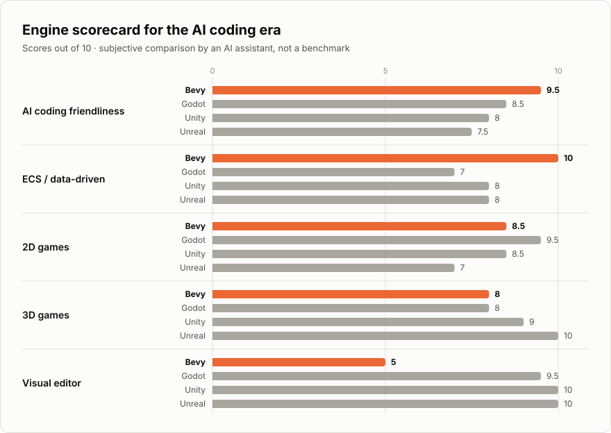

<div align="center">


# Playmand

### Rust + Bevy Game Skill for AI Agents

Describe a game. Your coding agent builds it in **Rust + Bevy**,<br/>
and makes the models, materials and animations in **Blender through MCP**.

[](https://bevy.org/)
[](https://rust-lang.org/)
[](https://code.claude.com/docs/en/skills)
[](https://learn.chatgpt.com/docs/build-skills)
[](LICENSE)

**English** | [简体中文](README.zh-CN.md)

</div>

## Why Bevy, now that agents write the code

<picture>
  <source media="(prefers-color-scheme: dark)" srcset="assets/scorecard-en-dark.svg">
  
</picture>

- **Top score for AI coding friendliness (9.5) and ECS / data-driven design (10).** In Bevy the whole game is plain Rust: components, systems and state, with no scene files or inspector settings hidden from the agent. Cargo's compiler and tests tell the agent right away when it got something wrong.
- **The weak spot is the visual editor (5), and agents don't need one.** Editors are built for humans clicking around. An agent works in code, and Playmand fills the visual side with Blender + MCP for assets and screenshot checks for what's on screen.
- **2D and 3D are solid (8–8.5).** That's enough for full games, not just prototypes.

<details>
<summary>Scores as a table</summary>

| Dimension | Bevy | Godot | Unity | Unreal |
| --- | ---: | ---: | ---: | ---: |
| AI coding friendliness | **9.5** | 8.5 | 8 | 7.5 |
| ECS / data-driven | **10** | 7 | 8 | 8 |
| 2D games | **8.5** | 9.5 | 8.5 | 7 |
| 3D games | **8** | 8 | 9 | 10 |
| Visual editor | **5** | 9.5 | 10 | 10 |

Scores are a subjective comparison produced by an AI assistant, not a benchmark. Regenerate the chart with `python assets/make_scorecard.py`.
</details>

## Make a game

```text
/playmand Build a top-down 2D action game with dashing, melee combat,
enemies that chase you, loot and leveling. Bright pixel art, punchy hit feedback.
```

Use `$playmand` in Codex. Setup takes one command (see [Installation](#installation)):

```sh
python scripts/install_skill.py --user --target both
```

## What Playmand is

**Playmand is a Rust + Bevy game development skill. It helps AI coding agents work fluently with this stack and turn game designs into playable 2D / 3D games.**

At its core is hands-on Rust + Bevy expertise: using the API of the version you actually have, structuring ECS and gameplay state, wiring up model animation, building UI and rendering, tracking down performance problems, and shipping builds. Codex, Claude Code and other skill-capable tools are the hosts that run it.

**Blender + MCP is a key part of asset creation**: the agent drives Blender through a connected MCP server to create and modify models, materials, rigs and animations, checks the result, exports GLB and brings it into Bevy. The skill covers the full technical path from editable asset to in-game result.

New games default to Rust + Bevy; existing Bevy projects keep their version and structure. If the user explicitly picks another engine, that choice is respected, and existing projects are never migrated automatically. The skill does not impose a fixed development loop, and it does not shrink the user's request into a minimal demo.

## Why Rust + Bevy + Agents

Rust's main appeal is performance and reliability: it compiles to native code with no garbage collector and gives fine-grained control over memory and resources, while its type system and ownership checks catch many memory and concurrency bugs at compile time. These traits suit games that care about frame time, resource usage and long-term maintainability. ([Rust](https://rust-lang.org/))

Bevy's ECS architecture organizes game logic around data, runs systems in parallel where possible, and its modular design is easy to extend. Gameplay, state and system behavior are all expressed in Rust code, which agents can read and modify, and get fast feedback on through Cargo builds and tests. ([Bevy introduction](https://bevy.org/learn/quick-start/introduction/))

The cost is a steep learning curve: ownership, borrowing, lifetimes, plus Bevy's queries, scheduling and resource management all have to be understood. Build times, version churn and hard-to-diagnose errors also slow iteration. Fast at runtime does not mean fast to develop.

**That is exactly where Playmand and agents fit together: keep the performance and engineering strengths of Rust + Bevy, and let the agent carry more of the implementation, API verification and debugging, lowering the cost of working with this stack.** You focus on gameplay, style and feel; Playmand gives the agent engine and asset-pipeline knowledge so it guesses fewer APIs and hits fewer pitfalls. Actual development speed and game quality are still measured on real projects and controlled evaluations.

## What's Included

| Content | How it helps |
| --- | --- |
| [Rust / Bevy toolchain](skills/playmand/references/bevy.md) | New project setup, version/API lookup, feature and plugin compatibility, builds and Windows linking |
| [ECS and gameplay state](skills/playmand/references/ecs.md) | Query borrow conflicts, deferred commands, system ordering, fixed-timestep input, pause and restart |
| [Blender and MCP](skills/playmand/references/blender-mcp.md) | Connection and capability discovery, scene editing, modeling/materials/animation, GLB export and Bevy integration |
| [Assets and animation](skills/playmand/references/assets-animation.md) | GLB sub-scenes, instance readiness, animation graph/player wiring, per-instance material and skeleton isolation |
| [Rendering, UI and performance](skills/playmand/references/rendering.md) | 2D/3D cameras, lighting, layers, UI layout, screenshots and preview camera lifecycle |
| [Version inspection script](skills/playmand/scripts/inspect_bevy.py) | Reports Bevy version, features, source locations and docs links from Cargo's actual resolved graph |
| [Runnable Rust example](skills/playmand/examples/ecs-patterns/src/lib.rs) | Four real Bevy ECS behavior tests, for understanding the API or narrowing down a bug |

The technical baseline is **Bevy 0.20.1 / Rust 1.97.1**. For other versions, check that version's source; existing projects should not be upgraded just to match the examples. Reference material is read on demand per problem; the full entry point is [SKILL.md](skills/playmand/SKILL.md).

> The skill's reference docs are currently written in Chinese. Agents read them fine regardless of the language you prompt in.

## Installation

Requires Codex or Claude Code, and Python 3.9+. The installer uses only the Python standard library. The engine, compiler, graphics and input tools a game needs are prepared per project; the installer never installs or purchases them.

To use Blender MCP, you also need to configure an MCP server in your host and enable the Blender-side add-on; installing the skill does not set up that connection. See the [Blender MCP guide](skills/playmand/references/blender-mcp.md) for details and boundaries.

```sh
git clone https://github.com/edison7009/Playmand.git
cd Playmand
python scripts/install_skill.py --user --target both
```

You can also download the GitHub ZIP, extract it, enter the folder and run the same Python command. To install for a single host, replace `both` with `codex` or `claude`. Without Python, copy the whole `skills/playmand` folder into the directory shown below.

| Host | Personal install (`--user`) | Project install | Explicit invocation |
| --- | --- | --- | --- |
| Codex | `~/.agents/skills/playmand/` | `.agents/skills/playmand/` | `$playmand help me ...` |
| Claude Code | `~/.claude/skills/playmand/` | `.claude/skills/playmand/` | `/playmand help me ...` |

`~` is the current user's home directory. A personal install is available across that user's projects; to share the skill with a team alongside a game project, use a project install:

```sh
python scripts/install_skill.py --project "/absolute/path/to/your/game" --target both
```

Choose one scope, not both, to avoid duplicate installs with the same name. A project install only copies into the given directory; the installer never touches game source or host configuration files. It refuses to proceed if a regular file occupies the install path, a same-named directory has different contents, or a path points outside the project.

Directory conventions follow the [Codex skill docs](https://learn.chatgpt.com/docs/build-skills) and [Claude Code skill docs](https://code.claude.com/docs/en/skills), checked on 2026-09-13. The shared skill body uses `name` / `description`, an MIT license marker and relative paths, with no host-specific directive syntax; `agents/openai.yaml` is extra display metadata for Codex.

After installing, open a new session in your game project, confirm the skill is discovered, then invoke it explicitly. Older hosts or ones restricted by organization policy need their loading behavior checked against their actual version; a successful file copy does not mean the host has loaded the skill. This applies to local Codex / Claude Code; cloud tasks need the skill brought into their actual execution environment.

The installer skips identical content and exits without overwriting when it finds a same-named directory with different contents. Build output (`target`) and Python caches are not copied and do not count as conflicts. To update: `git pull`, review the diff, move the old install outside the skill discovery directory for safekeeping, then reinstall; installed copies do not sync automatically. The source of truth is `skills/playmand` in this repository.

## Usage

New game in Codex:

```text
$playmand Build a top-down 2D action game with Rust + Bevy.
It needs dashing, melee attacks, enemy pursuit, loot drops and leveling,
plus complete start, pause and results screens.
Use a bright pixel-art style, with strong hit feedback and tight controls.
```

Existing project:

```text
$playmand Fix the current Bevy project: the GLB character renders, but its animation doesn't play.
Keep the versions in Cargo.lock, and check the scene instance, AnimationPlayer and animation graph wiring.
```

Asset creation:

```text
$playmand Use the connected Blender MCP to make a low-poly treasure chest with a lid-opening animation.
Keep the editable .blend, export GLB, bring it into the current Bevy project, and play the animation on click.
```

In Claude Code, replace `$playmand` with `/playmand`. Other hosts can load the whole `skills/playmand` folder according to their own skill mechanism; this repository's installer only targets Codex and Claude Code and does not claim every tool has been tested.

## Validation and Maintenance

- [Validation record](VALIDATION.md): install, host and distribution checks performed, and the current validation scope.
- [Evaluation cases](docs/evaluation.md): evaluate correctness, development time and human intervention on real game tasks.

Maintainers can check and package locally:

```sh
python -B -m unittest discover -s tests -v
python scripts/build_package.py
```

Run the real Bevy example separately (requires the Rust 1.97.1 toolchain):

```sh
cd skills/playmand/examples/ecs-patterns
cargo test --locked
```

The packaging script uses an explicit public-file allowlist and produces `dist/playmand-0.3.0.zip` plus a SHA-256 manifest. GitHub Actions runs the same tests on Windows and Linux. Host behavior and engine/GPU validation scopes are documented in [VALIDATION.md](VALIDATION.md); passing installation does not imply any game will be completed automatically.

## License

Playmand is released under the [MIT License](LICENSE).
