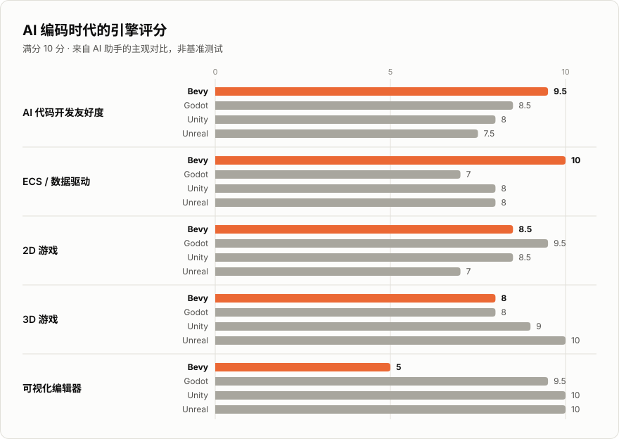

<div align="center">


# Playmand

### Rust + Bevy Skill for AI Agents · Games & Videos

让 AI 熟练地用 **Rust + Bevy** 做出游戏和视频，<br/>
而且效果出色。

[](https://bevy.org/)
[](https://rust-lang.org/)
[](https://code.claude.com/docs/en/skills)
[](https://learn.chatgpt.com/docs/build-skills)
[](LICENSE)
[](https://skills.sh/edison7009/Playmand)

[English](README.md) | **简体中文**

</div>

<p align="center">
  
</p>

<p align="center"><a href="https://github.com/edison7009/Playmand/releases/download/demo-videos/playmand-icons-1080p.mp4"><b>▶ 观看 1080p 高清视频（MP4）</b></a></p>

<p align="center"><sub>用 Playmand 制作：3600 个 Bevy 粒子化作在 3D 中滚动的圆形星云，再以四种不同方式汇聚成 Claude 和 ChatGPT 图标。<br/>粉丝致敬作品，与 Anthropic、OpenAI 无关联，也未获其认可；Claude 与 ChatGPT 分别为其所有者的商标。</sub></p>

## 为什么在 AI 写代码的时代选 Bevy

<picture>
  <source media="(prefers-color-scheme: dark)" srcset="assets/scorecard-zh-dark.svg">
  
</picture>

- **AI 代码开发友好度（9.5）和 ECS / 数据驱动（10）两项最高。** Bevy 游戏完全由 Rust 代码构成：组件、系统和状态都写在代码里，没有藏在场景文件或编辑器面板里、Agent 看不到的设置。Cargo 的编译和测试能立刻告诉 Agent 哪里写错了。
- **短板是可视化编辑器（5），而 Agent 恰恰不需要它。** 编辑器是给人点来点去用的，Agent 直接写代码。画面这一侧由 Playmand 补上：用 Blender + MCP 做资产，用截图检查实际画面。
- **2D 和 3D 都够用（8–8.5）。** 足以做完整游戏，不只是原型。

<details>
<summary>评分表格</summary>

| 维度 | Bevy | Godot | Unity | Unreal |
| --- | ---: | ---: | ---: | ---: |
| AI 代码开发友好度 | **9.5** | 8.5 | 8 | 7.5 |
| ECS / 数据驱动 | **10** | 7 | 8 | 8 |
| 2D 游戏 | **8.5** | 9.5 | 8.5 | 7 |
| 3D 游戏 | **8** | 8 | 9 | 10 |
| 可视化编辑器 | **5** | 9.5 | 10 | 10 |

评分来自 AI 助手的主观对比，不是基准测试。修改分数后运行 `python assets/make_scorecard.py` 重新生成图表。
</details>

## 为什么是 Rust：C 级速度，编译器替 Agent 把关

<picture>
  <source media="(prefers-color-scheme: dark)" srcset="assets/langspeed-zh-dark.svg">
  
</picture>

- **27 种语言中速度第 2、能效第 2。** 在上图的研究中，Rust 的执行时间是 C 的 1.04 倍，能耗是 C 的 1.03 倍，领先 C++（1.56 倍 / 1.34 倍），更远超常用的游戏脚本语言：C# 3.14 倍、JavaScript 6.52 倍、Python 71.90 倍、Lua 82.91 倍。
- **没有垃圾回收。** 不会因为回收内存突然卡一帧，游戏和长时间渲染的帧时间都更稳定。
- **编译器替 Agent 审代码。** 类型、所有权和借用检查在程序运行前就拦下空指针、数据竞争和内存错误。Agent 拿到的是精确的报错信息，而不是运行时崩溃，这正是 Agent 最擅长利用的反馈。
- **一套工具链。** `cargo` 负责构建、测试和格式化，`Cargo.lock` 锁定所有依赖，不需要每个项目各选一套构建系统。
- **代价也是真实的：编译慢、学习曲线陡。** 对人来说，这是不选 Rust 的主要原因；对 Agent 来说，严格反而是帮助，Bevy 的细节由 Playmand 补上。

| | Rust | C++ | C# | GDScript | Python | TypeScript |
| --- | --- | --- | --- | --- | --- | --- |
| 执行时间（相对 C） | **1.04 倍** | 1.56 倍 | 3.14 倍 | 未测¹ | 71.90 倍 | 46.20 倍 |
| 内存管理 | **所有权，无 GC** | 手动 | GC | 引用计数 | 引用计数 + GC | GC |
| 运行前能发现的错误 | **类型、所有权、借用** | 类型 | 类型 | 可选类型 | 默认没有 | 类型（运行时擦除） |
| 标准构建工具 | **cargo** | 没有（CMake 等） | dotnet | Godot 编辑器 | pip、uv 等 | npm、pnpm 等 |
| 编译速度 | 慢 | 慢 | 快 | 无需编译 | 无需编译 | 快 |

¹ GDScript 是解释型语言，不在该研究范围内。数据来自研究中 2017 年 Computer Language Benchmarks Game 的程序；运行 `python assets/make_langchart.py` 重新生成图表。

## 用 Playmand 做的演示

游戏和视频来自同一套代码：能实时游玩的 Bevy 场景，也能逐帧录制成无缝循环的动画。下面两个演示都由 AI 编程 Agent（Claude Code）借助本技能编写。

| 鹈鹕骑自行车 | ECS 星系 |
| :---: | :---: |
|  |  |
| 著名的"鹈鹕骑自行车"大模型测试（由 Simon Willison 推广）。这里不是画一张 SVG，而是一个会动的 Bevy 场景：车轮转速和路面速度匹配，双腿用两段式 IK 跟着踏板转。 | 4000 个星星实体，HDR 辉光，由一个并行 ECS 系统驱动。内圈星星转得更快，旋臂会先卷紧，每轮结束时又回到初始形状。 |
| [▶ 观看 1080p 高清视频（MP4）](https://github.com/edison7009/Playmand/releases/download/demo-videos/playmand-pelican-1080p.mp4) | [▶ 观看 1080p 高清视频（MP4）](https://github.com/edison7009/Playmand/releases/download/demo-videos/playmand-galaxy-1080p.mp4) |

源码：[`pelican.rs`](demos/src/bin/pelican.rs)、[`galaxy.rs`](demos/src/bin/galaxy.rs)，以及页首动画 [`icons.rs`](demos/src/bin/icons.rs)。在 `demos/` 目录运行 `cargo run --bin pelican`、`galaxy` 或 `icons`。加上 `-- --record frames` 可录制一个无缝循环，再用 `python demos/encode.py frames out.webp` 生成动画。

### 在浏览器里直接玩：用 Rust 构建的抽卡系统

<a href="https://playmand.com/zh/"></a>

<p align="center"><a href="https://playmand.com/zh/"><b>▶ 在线体验</b></a> · 撕开卡包，再把鼠标移到卡片上</p>

Rust 编译成 WebAssembly，在普通网页里直接用 WebGL2 绘制：没有游戏引擎，也没有 JavaScript 3D 库，代码仅 66 KB（WebAssembly + JS，gzip 压缩后）。沿随机裂口撕开铝箔卡包，五张卡从开口升起并依次翻成正面，每张都有真实厚度、随倾斜反光的透明涂层，以及浮在卡面上方的角色。角色用 Bevy 建模渲染。它最初是 [EchoBird](https://github.com/edison7009/EchoBird) 的 TokenPet 功能。源码与构建说明见 [`web/`](https://github.com/edison7009/Playmand/tree/main/web)，经验总结写进了技能的[网页特效指南](docs/zh-CN/playmand/references/web-wasm.md)。

## 做一个游戏或视频

```text
/playmand 做一个俯视角 2D 动作游戏，有冲刺、近战、追踪玩家的敌人、掉落和升级。
明亮的像素风，打击反馈要有力。
```

```text
/playmand 做一段 6 秒无缝循环动画：我们的 logo 由发光粒子汇聚而成，
1920x1080，导出 MP4，另导出一份 WebP 放进 README。
```

Codex 中使用 `$playmand`。在 Claude Code 中一行即可安装（其他 Agent 见 [安装](#安装)）：

```text
/plugin install playmand --marketplace edison7009/Playmand
```

## Playmand 是什么

**Playmand 是 Rust + Bevy 的游戏与视频 Skill，目标是让 AI 更熟练地使用这套技术栈，把设计实现为可玩的 2D / 3D 游戏，或逐帧录制的动画视频。**

核心是 Rust + Bevy 的具体开发能力：正确使用当前版本的 API、组织 ECS 与玩法状态、接入模型动画、实现 UI 和渲染、定位性能问题并构建游戏。Codex、Claude Code 及其他支持技能的工具是使用它的宿主。

**Blender + MCP 是资产制作的重要组成部分**：AI 通过已连接的 MCP 操作 Blender，制作和修改模型、材质、骨骼与动画，检查结果后导出 GLB 并接入 Bevy。技能覆盖从可编辑资产到游戏内呈现的技术衔接。

新建游戏默认 Rust + Bevy；已有 Bevy 工程保留其版本和结构。用户明确选用其他引擎时尊重选择，不自动迁移已有项目。技能不规定固定开发循环，也不把用户要求缩减成最小演示。

## 为什么是 Rust + Bevy + Agent

Rust 的吸引力首先在于运行效率和可靠性：编译为原生代码、无需垃圾回收，并能精细控制内存与资源；类型系统和所有权检查可以在编译阶段发现许多内存与并发错误。这些特性适合重视帧时间、资源占用和长期维护的游戏项目。[Rust 官方介绍](https://rust-lang.org/)

Bevy 的 ECS 架构围绕数据组织游戏逻辑，支持在条件允许时并行执行系统，模块化设计也便于按需求扩展。玩法、状态和系统行为可以通过 Rust 代码表达，方便 Agent 阅读、修改，并结合 Cargo 编译和测试获得反馈。[Bevy 官方介绍](https://bevy.org/learn/quick-start/introduction/)

代价是代码门槛较高：所有权、借用、生命周期，以及 Bevy 的查询、调度和资源管理，都需要开发者理解。构建耗时、版本变化和复杂错误排查也会增加迭代成本。运行效率高，并不意味着开发过程天然更快。

**这正是 Playmand 与 Agent 结合的核心：发挥 Rust + Bevy 的性能与工程优势，让 Agent 承担更多代码实现、API 查证和问题定位，降低驾驭这套技术栈的成本。** 用户把精力放在玩法、风格和体验判断上，Playmand 为 Agent 补充引擎与资产制作知识，帮助它少猜接口、少踩技术陷阱。实际开发效率与游戏质量，仍通过具体项目和对照评估检验。

## 提供什么

| 内容 | 具体帮助 |
| --- | --- |
| [Rust / Bevy 工具链](docs/zh-CN/playmand/references/bevy.md) | 新工程配置、版本/API 定位、feature 与插件兼容、编译及 Windows 链接 |
| [ECS 与玩法状态](docs/zh-CN/playmand/references/ecs.md) | Query 借用冲突、延迟命令、系统顺序、固定时间步输入、暂停与重开 |
| [Blender 与 MCP](docs/zh-CN/playmand/references/blender-mcp.md) | 连接与能力发现、场景编辑、模型/材质/动画制作、GLB 导出及 Bevy 接入 |
| [资源与动画](docs/zh-CN/playmand/references/assets-animation.md) | GLB 子场景、实例就绪、动画图/播放器接线、材质与骨骼实例隔离 |
| [渲染、UI 与性能](docs/zh-CN/playmand/references/rendering.md) | 2D/3D 相机、灯光、图层、UI 布局、截图与预览相机生命周期 |
| [演示动画与视频录制](docs/zh-CN/playmand/references/video.md) | 固定时钟逐帧录制、无缝循环、辉光、WebP/GIF/MP4 编码 |
| [版本检查脚本](skills/playmand/scripts/inspect_bevy.py) | 从 Cargo 实际解析图报告 Bevy 版本、features、源码位置和文档入口 |
| [可运行 Rust 示例](skills/playmand/examples/ecs-patterns/src/lib.rs) | 四项真实 Bevy ECS 行为测试，可用于理解 API 或缩小故障 |

技术示例基线为 **Bevy 0.20.1 / Rust 1.97.1**。其他版本需查对应源码，已有项目不应为套用示例而升级。辅助资料按问题读取，完整入口见 [SKILL.md](skills/playmand/SKILL.md)（英文，Agent 实际加载的版本）；中文副本见 [docs/zh-CN/playmand](docs/zh-CN/playmand/README.md)。

## 安装

**Claude Code（2.1.275 及以上）**：直接从本仓库安装插件：

```text
/plugin install playmand --marketplace edison7009/Playmand
```

较旧版本先运行 `/plugin marketplace add edison7009/Playmand`，再运行 `/plugin install playmand@playmand`。

**任何支持 Skill 的 Agent（通过 [skills.sh](https://skills.sh)）**：需要 Node.js：

```sh
npx skills add edison7009/Playmand
```

**Codex 和 Claude Code，使用自带安装器**：需要选择个人或项目范围，或不想装 Node.js 时使用：

要求已安装 Codex 或 Claude Code，以及 Python 3.9+。安装器仅使用 Python 标准库；游戏开发所需的引擎、编译器、图形与输入工具按目标项目准备。它不会自动安装或购买这些工具。

使用 Blender MCP 时，还需在实际宿主配置相应 MCP 服务并启用 Blender 端插件；技能安装不会自动完成连接。具体实现与接入边界见 [Blender MCP 指南](docs/zh-CN/playmand/references/blender-mcp.md)。

```sh
git clone https://github.com/edison7009/Playmand.git
cd Playmand
python scripts/install_skill.py --user --target both
```

也可下载 GitHub 的 ZIP，解压并进入目录后执行同一个 Python 命令。若只安装一个宿主，将 `both` 改成 `codex` 或 `claude`。不使用 Python 时，手动复制整个 `skills/playmand` 文件夹到下表目录。

| 宿主 | 个人安装（`--user`） | 项目安装 | 显式调用 |
| --- | --- | --- | --- |
| Codex | `~/.agents/skills/playmand/` | `.agents/skills/playmand/` | `$playmand 帮我完成……` |
| Claude Code | `~/.claude/skills/playmand/` | `.claude/skills/playmand/` | `/playmand 帮我完成……` |

`~` 表示当前用户主目录。个人安装可供该用户多个项目使用；要把技能随游戏项目共享给团队，改用项目安装：

```sh
python scripts/install_skill.py --project "已有游戏项目的绝对路径" --target both
```

两个范围二选一，避免同名重复安装。项目安装只复制到指定目录内；安装器不会改动游戏源码或宿主配置文件。普通文件占用安装路径、同名不同内容或指向项目外的路径会被拒绝。

目录规则参照 [Codex 官方 Skill 文档](https://learn.chatgpt.com/docs/build-skills) 与 [Claude Code 官方 Skill 文档](https://code.claude.com/docs/en/skills)，2026-09-13 核对。共享正文使用 `name` / `description`、MIT 许可标记和相对路径，不依赖宿主专有指令语法；`agents/openai.yaml` 是 Codex 附加显示信息。

安装后打开游戏项目的新会话，检查技能是否被发现，再显式调用。更旧或受组织策略限制的宿主需按其实际版本确认加载行为；文件复制成功不等于宿主已加载。这里指本地 Codex / Claude Code，云端任务还需将技能带入其实际执行环境。

安装器遇到相同内容会跳过，遇到同名但不同内容的目录会退出且不覆盖。示例构建产生的 `target` 和 Python 缓存不复制，也不作为内容冲突。更新时先 `git pull`，检查新旧差异并把旧安装目录移到技能发现目录之外留存，再重新安装；安装副本不自动同步。源文件统一维护在本仓库 `skills/playmand`。

## 使用

Codex 新游戏示例：

```text
$playmand 用 Rust + Bevy 开发一个俯视角 2D 动作游戏。
需要冲刺、近战攻击、敌人追踪、掉落和升级，以及完整的开始、暂停和结算界面。
画面采用明亮的像素风格，重点做好打击反馈和操作手感。
```

现有工程示例：

```text
$playmand 修复当前 Bevy 工程：GLB 角色已经显示，但动画不播放。
沿用 Cargo.lock 的版本，检查场景实例、AnimationPlayer 和动画图的接线。
```

资产制作示例：

```text
$playmand 通过已连接的 Blender MCP 制作一个低多边形宝箱，包含开盖动画。
保留可编辑的 .blend，导出 GLB，接入当前 Bevy 工程，点击后播放开盖动画。
```

Claude Code 将 `$playmand` 换成 `/playmand`。其他宿主按其技能加载方式使用整个 `skills/playmand` 目录；本仓库安装器只提供 Codex 和 Claude Code 的目录适配，不宣称所有工具已测试兼容。

## 验证与维护

- [验证记录](VALIDATION.md)：已执行的安装、宿主与分发检查，以及当前验证范围。
- [评估用例](docs/evaluation.md)：用实际游戏任务评估正确性、开发耗时和人工接管情况。

维护者可在本地检查和打包：

```sh
python -B -m unittest discover -s tests -v
python scripts/build_package.py
```

真实 Bevy 示例另行运行（需 Rust 1.97.1 工具链）：

```sh
cd skills/playmand/examples/ecs-patterns
cargo test --locked
```

打包脚本使用明确的公开文件清单，生成 `dist/playmand-0.3.0.zip` 和 SHA-256 清单。GitHub Actions 在 Windows 与 Linux 上运行相同测试。宿主行为验证和引擎/GPU 验证的范围分别记录在 [VALIDATION.md](VALIDATION.md)，不以安装通过宣称任意游戏都能自动完成。

## 许可证

Playmand 采用 [MIT 许可证](LICENSE)。
